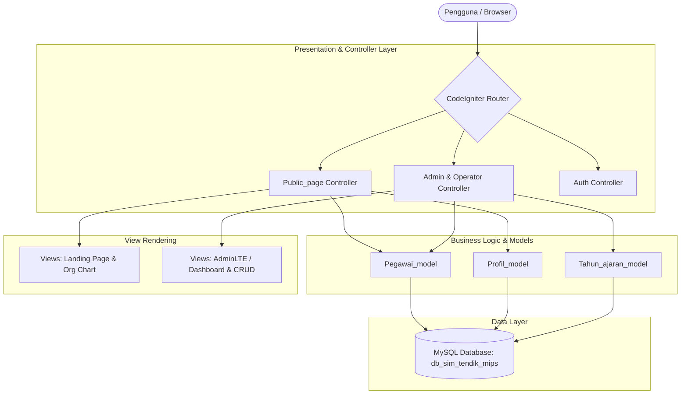

# SIM Tendik & Data Guru — MIPS
> **Sistem Informasi Manajemen Tenaga Pendidik & Kependidikan Berbasis Web**  
> *Dikembangkan untuk PKBM Madina Islamic Premier School (MIPS)*

[](https://www.php.net/)
[](https://codeigniter.com/)
[](https://www.mysql.com/)
[](https://getbootstrap.com/)
[](https://prestianhanif.github.io/mips-academic-suite)

---

## 📌 Ringkasan Proyek (Overview)

**SIM Tendik & Guru MIPS** adalah aplikasi web enterprise-level yang dirancang untuk mendigitalisasi pengelolaan profil pendidik, tenaga kependidikan (tendik), dan staf karyawan non-tendik secara terpusat, transparan, dan akuntabel.

Sebelum sistem ini dibangun, data kepegawaian tersebar di berbagai dokumen spreadsheet manual, menyulitkan rekapitulasi data, pelacakan histori karir, serta pelaporan ke yayasan dan dinas. Sistem ini hadir dengan arsitektur **Role-Based Access Control (RBAC)** dan landing page publik yang ramah pengguna.

---

## ✨ Fitur Utama (Key Features)

### 1. 🌐 Portal Publik & Transparansi Kelembagaan (Tanpa Login)
* **Struktur Organisasi Interaktif:** Bagan hierarki kepemimpinan dan penugasan staf yang terstruktur.
* **Statistik Real-time:** Dashboard ringkasan total pegawai aktif, rasio gender, kategori tendik/non-tendik, dan status kerja (*stay/onsite/remote*).
* **Direktori Guru & Alumni:** Pencarian cepat direktori profil umum tenaga pengajar serta arsip riwayat alumni pendidik.

### 2. 🛡️ Portal Administrasi & Manajemen (Admin & Operator)
* **Master Data Pegawai (CRUD Lengkap):** Pengelolaan NIP, NUPTK, data pribadi, riwayat pendidikan, kontak darurat, dan arsip dokumen pendukung.
* **Filter Multi-Kriteria:** Filter cepat berdasarkan unit, jenis kelamin, sistem kerja (*stay / pulang-pergi*), dan status keaktifan.
* **Manajemen Unit & Jabatan:** Fleksibilitas pemetaan struktur organisasi sekolah.
* **Laporan & Ekspor Data:** Fitur ekspor ke format Excel dan cetak PDF siap saji untuk kebutuhan rapat yayasan dan akreditasi.

### 3. 👥 Hak Akses Terkontrol (RBAC)
* **Super Admin:** Kontrol penuh atas basis data, manajemen user, dan konfigurasi master data.
* **Operator / TU:** Penginputan data harian dan pembaruan data berkala.
* **Guru / Pegawai (Read-Only Login):** Akses transparansi data internal rekan sejawat tanpa hak mengubah data institusional.

---

## 🏗️ Arsitektur Sistem (System Architecture)

Aplikasi ini menggunakan pola desain **Model-View-Controller (MVC)** yang terstruktur rapi:



---

## 💻 Tech Stack

* **Backend:** PHP 7.4 / 8.2 (CodeIgniter 3.x Framework)
* **Database:** MySQL / MariaDB (Relational schema with normalized foreign keys)
* **Frontend:** Bootstrap 4, AdminLTE components, FontAwesome 5
* **Libraries & Plugins:** DataTables (Server-side & client-side filtering), jQuery, SweetAlert2, Chart.js

---

## 🚀 Panduan Instalasi Lokal (Local Setup)

Untuk menjalankan proyek ini di lingkungan lokal (XAMPP / Laragon):

### Prasyarat
* Web Server (Apache)
* PHP 7.4 atau PHP 8.x
* MySQL / MariaDB

### Langkah-langkah
1. **Clone repositori ini:**
   ```bash
   git clone https://github.com/PrestianHanif/app-dataguru.git
   cd app-dataguru
   ```

2. **Setup Database:**
   * Buka phpMyAdmin (`http://localhost/phpmyadmin`).
   * Buat database baru dengan nama `db_sim_tendik_mips`.
   * Import file database dari folder `db/` (atau `db_export_hostinger.sql`).

3. **Konfigurasi Aplikasi:**
   * Buka file `application/config/config.php`, sesuaikan URL dasar:
     ```php
     $config['base_url'] = 'http://localhost/app-dataguru/';
     ```
   * Buka file `application/config/database.php`, sesuaikan kredensial database lokal:
     ```php
     'hostname' => 'localhost',
     'username' => 'root',
     'password' => '',
     'database' => 'db_sim_tendik_mips',
     ```

4. **Akses Aplikasi:**
   * Buka browser dan arahkan ke: `http://localhost/app-dataguru/`

---

## 👤 Author & Maintainer

* **Prestian Hanif**
* Portfolio: [GitHub](https://github.com/PrestianHanif) | [LinkedIn](https://linkedin.com) | [Glints](https://glints.com)

---

## 📄 Lisensi
Proyek ini dilisensikan di bawah lisensi institusional PKBM Madina Islamic Premier School.
