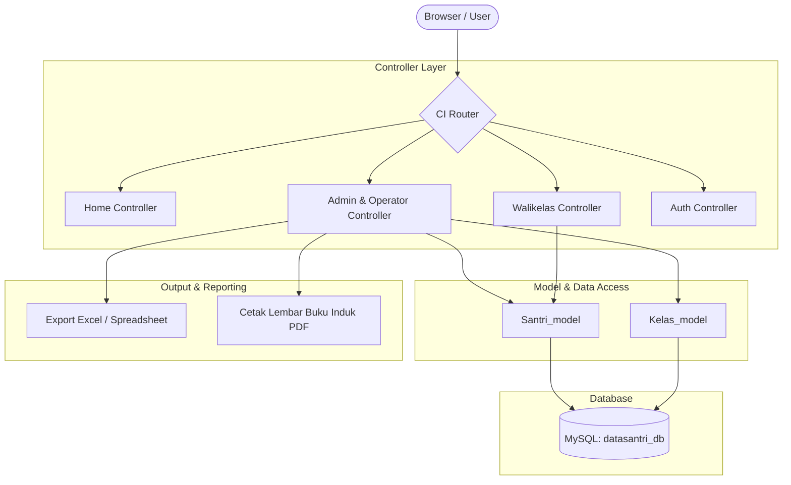

# SIM Santri & Buku Induk Digital — MIPS
> **Sistem Informasi Manajemen Data Santri & Arsip Buku Induk Digital Terpadu**  
> *Dikembangkan untuk PKBM Madina Islamic Premier School (MIPS)*

[](https://www.php.net/)
[](https://codeigniter.com/)
[](https://www.mysql.com/)
[](https://getbootstrap.com/)
[](https://prestianhanif.github.io/mips-academic-suite)

---

## 📌 Ringkasan Proyek (Overview)

**SIM Santri & Buku Induk Digital MIPS** adalah solusi sistem informasi akademik yang menggantikan pencatatan buku induk konvensional berbasis kertas menjadi arsip digital yang aman, terintegrasi, dan mudah ditelusuri (*searchable*).

Sistem ini melayani seluruh siklus data santri sejak awal masuk (baik santri reguler maupun santri pindahan), pencatatan perkembangan kelas, hingga kelulusan atau mutasi keluar. Dilengkapi dengan standardisasi penomoran induk (NIS) otomatis dan validasi data terstruktur.

---

## ✨ Fitur Utama (Key Features)

### 1. 📖 Digital Buku Induk Santri (Master Book)
* **Profil Lengkap Santri:** Biodata santri (NIK, NISN, NIS, tempat/tanggal lahir, riwayat kesehatan, golongan darah).
* **Data Orang Tua & Wali:** Informasi ayah, ibu, pekerjaan, penghasilan, alamat domisili, dan kontak darurat.
* **Cetak Lembar Buku Induk:** Format cetak standar buku induk kesiswaan resmi siap arsip fisik.

### 2. 🔄 Manajemen Santri Pindahan & Histori Mutasi
* **Pelacakan Santri Pindahan:** Fitur khusus untuk mencatat asal sekolah, NPSN, nomor surat pindah, dan riwayat nilai adaptasi.
* **Mutasi & Kelulusan:** Riwayat status santri (Aktif, Lulus, Pindah Keluar, Tidak Aktif).

### 3. 🔍 Filter & Rekapitulasi Dinamis
* **Pencarian Multi-parameter:** Pencarian instan berdasarkan NIS, nama, kelas, rombel, gender, dan status domisili.
* **Statistik Visual:** Dashboard ringkasan total santri aktif, distribusi per kelas, dan rasio pendaftar.

### 4. 👥 Hak Akses Multi-Level (RBAC)
* **Admin / TU:** Hak penuh input, edit, mutasi santri, dan manajemen akun pengguna.
* **Wali Kelas:** Akses verifikasi data santri di rombel binaannya dan pelaporan absensi/keaktifan.
* **Guru Pengajar:** Hak akses baca (*read-only*) untuk memudahkan identifikasi santri.

---

## 🏗️ Arsitektur Sistem (System Architecture)



---

## 💻 Tech Stack

* **Backend:** PHP 7.4 / 8.2 (CodeIgniter 3.x Framework)
* **Database:** MySQL / MariaDB (Tabel terelasi dengan integritas referensial kuat)
* **Frontend:** AdminLTE, Bootstrap 4, DataTables, jQuery
* **Export Utilities:** PHPSpreadsheet / FPDF / DOMPDF

---

## 🚀 Panduan Instalasi Lokal (Local Setup)

1. **Clone repositori:**
   ```bash
   git clone https://github.com/PrestianHanif/app-datasantri.git
   cd app-datasantri
   ```
2. **Setup Database:**
   * Buat database bernama `datasantri_db` di phpMyAdmin.
   * Import database dari folder `db/`.
3. **Konfigurasi:**
   * Atur `base_url` di `application/config/config.php` ke `http://localhost/app-datasantri/`.
   * Atur username & password di `application/config/database.php`.
4. **Jalankan:**
   * Akses `http://localhost/app-datasantri/` melalui web browser.

---

## 👤 Author & Maintainer

* **Prestian Hanif**
* Portfolio: [GitHub](https://github.com/PrestianHanif) | [LinkedIn](https://linkedin.com) | [Glints](https://glints.com)

---

## 📄 Lisensi
Proyek ini dilisensikan di bawah lisensi institusional PKBM Madina Islamic Premier School.
