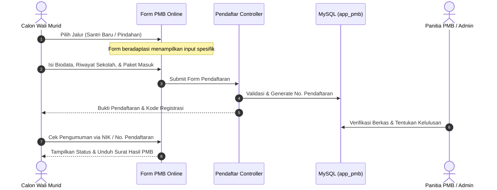

# Portal PMB Terpadu — MIPS
> **Sistem Informasi Penerimaan Murid Baru & Santri Pindahan Berbasis Web**  
> *Dikembangkan untuk PKBM Madina Islamic Premier School (MIPS)*

[](https://www.php.net/)
[](https://codeigniter.com/)
[](https://www.mysql.com/)
[](https://getbootstrap.com/)
[](https://prestianhanif.github.io/mips-academic-suite)

---

## 📌 Ringkasan Proyek (Overview)

**Portal PMB Terpadu MIPS** adalah aplikasi registrasi dan seleksi penerimaan murid/santri baru yang dirancang untuk mempermudah calon wali murid mendaftar secara online tanpa hambatan antrean fisik.

Aplikasi ini mengimplementasikan logika formulir pintar (*Smart Conditional Logic Form*) yang secara otomatis membedakan alur isian dan validasi dokumen antara **Santri Baru (Reguler)** dan **Santri Pindahan (Transfer Student)**, lengkap dengan modul pengumuman hasil seleksi (*Hasil PMB*) dan integrasi master data.

---

## ✨ Fitur Utama (Key Features)

### 1. 📝 Formulir Pendaftaran Terpadu (Smart Form)
* **Logika Percabangan Otomatis (*Conditional Logic*):** Pertanyaan beradaptasi secara dinamis berdasarkan jalur pilihan (Santri Baru vs Santri Pindahan).
* **Validasi Asal Sekolah:** Penginputan otomatis NPSN, NISN sekolah asal, dan alasan kepindahan bagi pendaftar mutasi.
* **Kalkulasi Biaya Masuk & Paket:** Pemilihan tier uang masuk fleksibel dan nominal custom terverifikasi sistem.

### 2. 📢 Portal Hasil Seleksi & Pengumuman Online
* **Pengecekan Status Instan:** Orang tua dapat memeriksa status penerimaan secara mandiri menggunakan nomor pendaftaran/NIK.
* **Unduh Bukti Diterima:** Cetak surat keterangan kelulusan PMB otomatis berformat PDF.

### 3. ⚙️ Dashboard Operator & Panitia PMB
* **Verifikasi Berkas:** Pemeriksaan keabsahan dokumen KK, Akta Lahir, dan Surat Pindah.
* **Penetapan Status:** Modul penentuan status seleksi (*Diterima / Cadangan / Menunggu Verifikasi*).
* **Export Rekapitulasi:** Unduh seluruh data pendaftar dalam format Excel untuk evaluasi kuota kelas.

---

## 🏗️ Alur Bisnis Pendaftaran (Admission Workflow)



---

## 💻 Tech Stack

* **Backend:** PHP 7.4 / 8.2 (CodeIgniter 3.x Framework)
* **Database:** MySQL / MariaDB
* **Frontend:** Bootstrap 4, jQuery Validation, FontAwesome, SweetAlert2
* **Reporting:** FPDF / PHPSpreadsheet

---

## 🚀 Panduan Instalasi Lokal (Local Setup)

1. **Clone repositori:**
   ```bash
   git clone https://github.com/PrestianHanif/app-pmb.git
   cd app-pmb
   ```
2. **Setup Database:**
   * Buat database baru bernama `app_pmb` di phpMyAdmin.
   * Import skema database dari `app_pmb_hosting.sql`.
3. **Konfigurasi:**
   * Atur `base_url` di `application/config/config.php` ke `http://localhost/app-pmb/`.
   * Atur koneksi di `application/config/database.php`.
4. **Jalankan:**
   * Buka browser dan arahkan ke: `http://localhost/app-pmb/`

---

## 👤 Author & Maintainer

* **Prestian Hanif**
* Portfolio: [GitHub](https://github.com/PrestianHanif) | [LinkedIn](https://linkedin.com) | [Glints](https://glints.com)

---

## 📄 Lisensi
Proyek ini dilisensikan di bawah lisensi institusional PKBM Madina Islamic Premier School.
